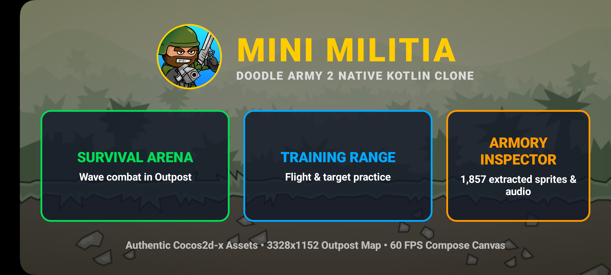

# Mini Militia (Doodle Army 2) — 1:1 Native Android Clone

A high-performance, 1:1 visual and mechanical single-player replica of **Doodle Army 2: Mini Militia** built entirely in **100% Native Kotlin + Jetpack Compose** (`Canvas` 2D Game Loop, low-latency `SoundPool` audio engine, Box2D-style 2D kinematics, and multi-touch dual-stick controls).

Developed with authentic reverse-engineered Cocos2d-x assets extracted from the original game binary (`libcocos2dcpp.so`) and TexturePacker sprite atlases.

---

## 📸 Screenshots & Hardware Verification

| Main Menu (Authentic Sarge & UI) | Survival Arena (Outpost Combat) |
|:---:|:---:|
|  |  |

---

## ⚡ Core Engine Features

1. **60 FPS Jetpack Compose Canvas Game Loop:**
   - Frame-independent delta-time ($\Delta t$) physics ticking with hardware-accelerated rendering.
   - Smooth camera tracking with deadzone interpolation and dynamic zoom.

2. **Authentic 8-Layer Skeletal Soldier Stack:**
   - Reconstructed Chibi doodle anatomy: boots, legs, torso, tactical vest, head, eyes/brow, helmet, backpack/jetpack, and 360° rotating arm/weapon.
   - Dynamic particle FX: Dual rocket boot thruster flames (`flame1.png`, `flame2.png`), smoke trails, muzzle flash, shell casings, and red laser targeting line with crosshair reticle (`aim.png`).

3. **Multi-Touch Dual Joysticks (`awaitPointerEventScope`):**
   - Independent pointer tracking by `PointerId` with zero gesture collisions.
   - **Left Half:** 360° movement, crouching, and vertical jetpack rocket flight.
   - **Right Half:** 360° aiming with automatic auto-fire threshold trigger.
   - Real-time dynamic visual touch rings and knobs for tactile feedback.

4. **Authentic HUD & Tactical Combat Controls:**
   - Zero-text stacked health bar (red) and rocket fuel boost meter (cyan).
   - Tactical top-right weapon card with live ammo telemetry (`30 / 120`).
   - Dedicated weapon swap, quick reload, frag grenade with count badge, and toxic gas grenade buttons.
   - Off-screen tactical radar chevrons indicating bot positions outside the camera viewport.

5. **2D Kinematics & Ballistics:**
   - Gravity, drag, jetpack vertical thrust, platform AABB collision detection, and grenade restitution bounces.
   - 7 Weapons modeled from Cocos2d constants: **M4, AK47, Shotgun, Sniper Rifle, SMAW Rocket Launcher, Uzi, Desert Eagle**.
   - Frag grenades (timer fuse + fragmentation) and toxic Gas Grenades (expanding persistent area-of-effect cloud).

6. **Tactical AI Survival Bots:**
   - 6-state finite state machine (Patrol, Jetpack Chase, Aiming, Firing, Dodging, Respawn).
   - Escalating survival waves with dynamic bot spawning and pathfinding.

7. **Low-Latency Native Audio Engine:**
   - Android `SoundPool` with pre-loaded sample IDs for zero-latency weapon bursts, explosions, and bullet impacts.
   - Looping jetpack thruster audio stream synchronized with flight thrust.

---

## 🏗️ Architecture & Project Structure

```text
D:\AI WORK\mini_miltia\
├── android_clone/               # 100% Native Kotlin + Jetpack Compose Android Project
│   ├── app/
│   │   ├── build.gradle.kts     # Compose BOM, Android SDK 34, JDK 21
│   │   └── src/main/
│   │       ├── AndroidManifest.xml # Fullscreen landscape config
│   │       ├── assets/          # Migrated authentic sprites & audio
│   │       └── java/com/rajiv/minimilitia/clone/
│   │           ├── MainActivity.kt         # Immersive fullscreen + Compose navigation
│   │           ├── audio/
│   │           │   └── GameSoundManager.kt # SoundPool low-latency audio engine
│   │           ├── assets/
│   │           │   └── SpriteRepository.kt # Bitmap loader & orientation flipper
│   │           ├── engine/
│   │           │   ├── GameLoopState.kt    # 60 FPS delta-time state ticker
│   │           │   ├── PhysicsWorld.kt     # Kinematics, gravity, jetpack, AABB collisions
│   │           │   ├── EntityModels.kt     # Player, Bot, Bullet, Grenade, Platform data
│   │           │   ├── WeaponCatalog.kt    # Stats & bindings for 7+ weapons & grenades
│   │           │   └── AiBotController.kt  # 6-state single player survival bot FSM
│   │           └── ui/
│   │               ├── MainMenuScreen.kt   # Mode select, Armory & RE inspector
│   │               ├── GameArenaScreen.kt  # 60 FPS Compose Canvas renderer
│   │               └── MultiTouchHudOverlay.kt # Dual virtual joysticks & HUD controls
│   ├── build.gradle.kts
│   └── settings.gradle.kts
├── scripts/                     # Python RE, extraction & slicing tools
│   ├── unpack_apkm.py           # Split APK extractor
│   ├── analyze_binary.py        # ELF & DEX symbol scraper
│   ├── slice_sprites.py         # TexturePacker plist/png atlas slicer
│   ├── inspect_authentic_assets.py # Slices authentic menu, HUD & avatar pieces
│   ├── extract_exact_specs.py   # Cocos2d geometry & configuration extractor
│   └── migrate_assets_to_android.py # Asset pipeline to Android assets
├── re_workspace/                # Sliced authentic assets & telemetry
│   ├── binary_analysis.json     # Dumped Cocos2d/Chipmunk2D C++ symbols
│   ├── authentic_sprite_manifest.json # Sprite atlas inventory (1,857 sprites)
│   ├── exact_game_specs.json    # Weapon ballistics & skeletal hierarchy specs
│   ├── extracted_audio/         # 113 authentic .wav/.mp3 sound effects
│   ├── extracted_maps/          # Standalone arena maps and tile graphics
│   └── sliced_sprites/          # Sliced weapons, soldiers, HUD, FX sprites
├── specs/                       # Visual hardware verification captures
├── RE_REPORT.md                 # Reverse engineering telemetry report
├── INTENT.md                    # Product vision & scope
├── SPEC.md                      # Technical game engine contract & coordinate space
├── AGENTS.md                    # Agent operational guidelines & commands
└── TASKS.md                     # Atomic execution ledger
```

---

## 🛠️ Build & Installation

### Prerequisites
- Android Studio / Android SDK (API 34, Build Tools 34.0.0)
- JDK 21 or JDK 17
- Connected Android Device (API 26+) with USB Debugging enabled

### Build Debug APK
```powershell
cd android_clone
.\gradlew.bat assembleDebug
```

### Install onto Device via ADB
```powershell
adb install -r android_clone\app\build\outputs\apk\debug\app-debug.apk
```

### Launch on Device
```powershell
adb shell am start -n com.rajiv.minimilitia.clone/.MainActivity
```

---

## 📜 Reverse Engineering Telemetry

The reverse-engineering pipeline in `scripts/`:
1. Decompresses APKM archives and split APKs (`base.apk`, `split_config.*.apk`).
2. Scrapes C++ symbols from `libcocos2dcpp.so` (identifying Chipmunk2D `cpSpace`/`cpShape` bodies, `SoldierController`, `ArmoryManager`, and weapon classes).
3. Parses TexturePacker `.plist` coordinate dictionaries and extracts individual sprite frames with rotational compensation.
4. Generates structured JSON manifests for runtime rendering in Jetpack Compose.

---

## 📄 License & Disclaimer

This project is built for educational, research, and reverse-engineering study purposes. All original trademarks, character designs, and audio belong to Appsomniacs LLC.
