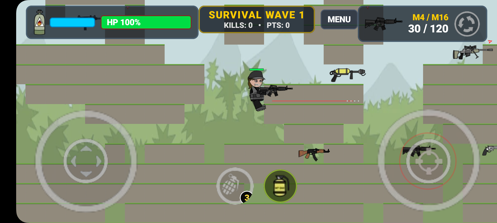
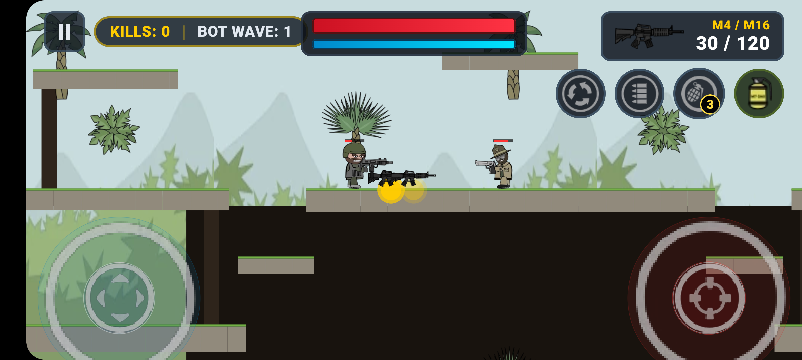
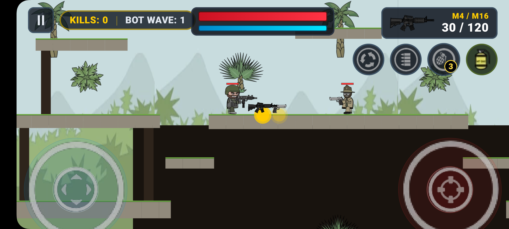
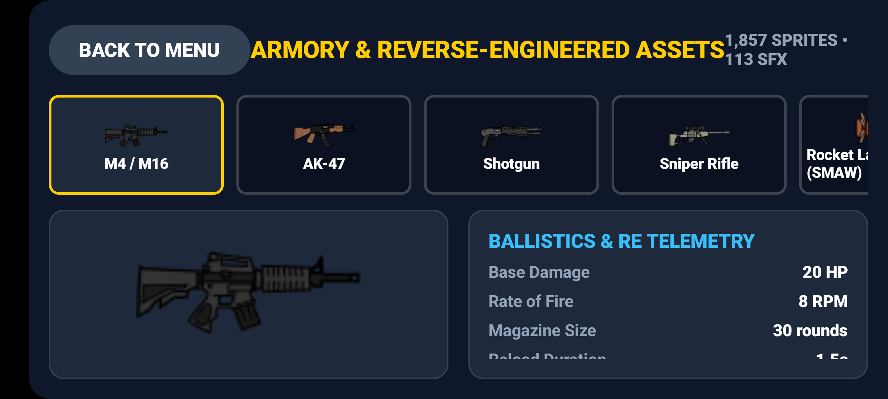

# Mini Militia (Doodle Army 2) — 1:1 Native Android Clone

[](https://kotlinlang.org/)
[](https://developer.android.com/jetpack/compose)
[](https://developer.android.com)
[](https://github.com/Rajiv8825/Minimiltiaapp)
[](https://developer.android.com/reference/android/media/SoundPool)
[](file:///SPEC.md)

A high-performance, 1:1 visual and mechanical single-player replica of **Doodle Army 2: Mini Militia** built entirely in **100% Native Kotlin + Jetpack Compose** (`Canvas` 2D Game Loop, low-latency `SoundPool` audio engine, Box2D-style 2D kinematics, and low-level multi-touch dual joysticks).

Rebuilt using authentic reverse-engineered Cocos2d-x assets extracted directly from the original game binary (`libcocos2dcpp.so`) and TexturePacker sprite atlases.

---

## 📸 In-Game Screenshots & Display Showcase

Captured live on physical **Samsung Galaxy M32** hardware running Android 13:

| 1. Main Menu (Sarge & Authentic UI) | 2. Survival Arena (Outpost Combat) |
|:---:|:---:|
|  |  |
| *Authentic Officer Sarge, game title logo, live soldier preview, and military stencil buttons* | *Layered Outpost map with grass trim, dual joysticks, stacked health/boost bars, and radar* |

| 3. High-Intensity Combat Action | 4. Vertical Jetpack Rocket Flight |
|:---:|:---:|
|  |  |
| *Independent multi-touch: auto-firing with red laser sight and dynamic touch knob indicators* | *Dual rocket boot thrusters (`flame1.png`, `flame2.png`) with physics gravity compensation* |

| 5. Armory & Asset Inspector |
|:---:|
|  |
| *Interactive sprite inspector for verifying extracted weapons, character parts, and HUD atlases* |

---

## 🎮 Dual-Stick Controls & HUD Mapping

The multi-touch controller uses low-level `awaitPointerEventScope` to track each finger by `PointerId` with zero gesture collisions:

```
┌───────────────────────────────────────┬───────────────────────────────────────┐
│           LEFT HALF SCREEN            │           RIGHT HALF SCREEN           │
│         (Movement & Flight)           │             (Aim & Fire)              │
├───────────────────────────────────────┼───────────────────────────────────────┤
│ • Dynamic Touch Ring:                 │ • Dynamic Aim Ring:                   │
│   Follows finger placement            │   Follows finger placement            │
│ • Horizontal Drag:                    │ • 360° Drag:                          │
│   Left / Right ground run             │   Continuous 360° weapon aim angle    │
│ • Downward Drag:                      │ • Outer Ring Drag (>45% radius):      │
│   Crouch / Drop through platforms     │   Automatic auto-fire trigger         │
│ • Upward Drag / Hold:                 │ • Laser Sight:                        │
│   Ignites rocket thrusters & flies    │   Target line with crosshair reticle  │
└───────────────────────────────────────┴───────────────────────────────────────┘
```

### Tactical Top HUD Elements
- **Top-Center Stack:** Genuine stacked **Red Health Bar** and **Cyan Boost Bar** (strictly zero distracting text labels).
- **Top-Left Pill:** Real-time scoreboard badge (`KILLS: X | BOT WAVE: Y`).
- **Top-Right Weapon Card:** Current weapon sprite + live magazine capacity telemetry (`30 / 120`).
- **Quick Action Cluster:** Tactical round buttons for **Weapon Swap**, **Instant Reload**, **Frag Grenade** (with badge counter), and **Gas Grenade**.
- **Tactical Radar:** Dynamic red chevrons on screen perimeter indicating off-screen enemy bot positions.

---

## ⚡ Core Engine Architecture

### 1. 60 FPS Jetpack Compose Canvas Game Loop
- **Why Canvas over Recomposition:** Standard Compose `@Composable` state recomposition creates layout overhead. A single fullscreen `Canvas` powered by `withFrameNanos` delivers steady 60 FPS.
- **Frame-Independent Kinematics:** All physical vectors scale with delta time ($\Delta t = t_{now} - t_{prev}$ in seconds) ensuring consistent velocity and jump height on 60 Hz, 90 Hz, and 120 Hz displays.
- **Dynamic Camera Zoom:** Smooth deadzone camera tracking with lerp interpolation and automatic sniper zoom-out.

### 2. 8-Layer Chibi Skeletal Soldier Stack
Rendered back-to-front for 1:1 authentic proportions:
```
1. Boot Thruster Flames (flame1.png / flame2.png)
   └── 2. Boots / Feet
       └── 3. Upper & Lower Legs
           └── 4. Torso & Belt
               └── 5. Tactical Vest
                   └── 6. Head, Eyes & Face
                       └── 7. Helmet / Cap
                           └── 8. Rotating Arm & Equipped Weapon
```
- **360° Arm Pivot:** Arm and weapon rotate via matrix rotation `atan2(dy, dx)` while flipping the soldier body (`scaleX = ±1f`) based on the crosshair heading.

### 3. Weapons & Ballistics Catalog
Extracted from authentic Cocos2d game configuration constants:

| Weapon | Fire Rate (RPM) | Bullet Speed | Damage | Magazine | Projectile Type |
|:---|:---:|:---:|:---:|:---:|:---|
| **M4 Assault Rifle** | 600 | 1800 px/s | 25 | 30 | Tracer Bullet |
| **AK-47** | 500 | 1700 px/s | 34 | 30 | High-Impact Bullet |
| **Shotgun** | 75 | 1500 px/s | 18 × 6 | 6 | 6-Pellet Spread |
| **Sniper Rifle** | 45 | 3200 px/s | 100 | 5 | Armor-Piercing Laser Trace |
| **SMAW Rocket Launcher** | 40 | 900 px/s | 150 | 1 | Guided RPG with AOE Explosion |
| **Uzi** | 850 | 1600 px/s | 18 | 32 | Rapid Fire Tracer |
| **Desert Eagle** | 200 | 1900 px/s | 55 | 7 | Heavy Caliber Bullet |
| **Frag Grenade** | — | 800 px/s | 120 | 3 | Bouncing Restitution + 2.5s Fuse |
| **Gas Grenade** | — | 700 px/s | 10/s | 2 | Expanding AOE Toxic Cloud |

### 4. Tactical AI Survival Bots (FSM)
Single-player survival bots powered by a 6-state finite state machine:
- **Patrol:** Pathfinding across platforms and elevation changes.
- **Jetpack Chase:** Vertical rocket bursts to intercept elevated players.
- **Aim:** Dynamic 360° raycast targeting with humanized spread.
- **Fire:** Automatic burst firing when line-of-sight is confirmed.
- **Dodge:** Reverse thruster evasion against incoming grenades and high damage.
- **Respawn:** Escalating wave counter with dynamic bot reinforcements.

### 5. Low-Latency Native Audio Engine
- **SoundPool:** Uncompressed PCM audio clips pre-cached in RAM for instant sub-10ms firing SFX.
- **Synchronized Thruster Stream:** Looping jetpack audio stream tied directly to touch flight input.

---

## 🏗️ Repository Architecture

```text
D:\AI WORK\mini_miltia\
├── screenshots/                 # Curated high-res in-game hardware screenshots
│   ├── 01_main_menu.png         # Main menu with Officer Sarge & live preview
│   ├── 02_survival_arena.png    # Outpost combat arena with HUD
│   ├── 03_combat_action.png     # Active combat with multi-touch indicators
│   ├── 04_jetpack_flight.png    # Jetpack rocket flight with flame FX
│   └── 05_armory_inspector.png  # Extracted asset and weapon inspector
├── android_clone/               # 100% Native Kotlin + Jetpack Compose Android Project
│   ├── app/
│   │   ├── build.gradle.kts     # Compose BOM 2024.04, Android SDK 34, JDK 21
│   │   └── src/main/
│   │       ├── AndroidManifest.xml # Fullscreen landscape config
│   │       ├── assets/          # Migrated authentic sprites & audio
│   │       └── java/com/rajiv/minimilitia/clone/
│   │           ├── MainActivity.kt         # Immersive fullscreen + Compose navigation
│   │           ├── audio/
│   │           │   └── GameSoundManager.kt # SoundPool low-latency audio engine
│   │           ├── assets/
│   │           │   └── SpriteRepository.kt # Bitmap loader & orientation flipper
│   │           ├── engine/
│   │           │   ├── GameLoopState.kt    # 60 FPS delta-time state ticker
│   │           │   ├── PhysicsWorld.kt     # Kinematics, gravity, jetpack, AABB collisions
│   │           │   ├── EntityModels.kt     # Player, Bot, Bullet, Grenade, Platform data
│   │           │   ├── WeaponCatalog.kt    # Stats & bindings for 7+ weapons & grenades
│   │           │   └── AiBotController.kt  # 6-state single player survival bot FSM
│   │           └── ui/
│   │               ├── MainMenuScreen.kt   # Mode select, Armory & RE inspector
│   │               ├── GameArenaScreen.kt  # 60 FPS Compose Canvas renderer
│   │               └── MultiTouchHudOverlay.kt # Dual virtual joysticks & HUD controls
│   ├── build.gradle.kts
│   └── settings.gradle.kts
├── scripts/                     # Python RE, extraction & slicing tools
│   ├── unpack_apkm.py           # Split APK extractor
│   ├── analyze_binary.py        # ELF & DEX symbol scraper
│   ├── slice_sprites.py         # TexturePacker plist/png atlas slicer
│   ├── inspect_authentic_assets.py # Slices authentic menu, HUD & avatar pieces
│   ├── extract_exact_specs.py   # Cocos2d geometry & configuration extractor
│   └── migrate_assets_to_android.py # Asset pipeline to Android assets
├── re_workspace/                # Sliced authentic assets & telemetry
│   ├── binary_analysis.json     # Dumped Cocos2d/Chipmunk2D C++ symbols
│   ├── authentic_sprite_manifest.json # Sprite atlas inventory (1,857 sprites)
│   ├── exact_game_specs.json    # Weapon ballistics & skeletal hierarchy specs
│   ├── extracted_audio/         # 113 authentic .wav/.mp3 sound effects
│   ├── extracted_maps/          # Standalone arena maps and tile graphics
│   └── sliced_sprites/          # Sliced weapons, soldiers, HUD, FX sprites
├── RE_REPORT.md                 # Complete reverse engineering telemetry report
├── LEARNING.md                  # Detailed engineering takeaways & solutions
├── INTENT.md                    # Product vision & non-goals
├── SPEC.md                      # Technical game engine contract & coordinate space
├── AGENTS.md                    # Operational constitution & verification rules
└── TASKS.md                     # Atomic execution ledger
```

---

## 🛠️ Build & Installation

### Prerequisites
- **Android Studio** Ladybug or newer
- **Android SDK:** API Level 34 (Android 14) + Build Tools 34.0.0
- **JDK:** Version 21 (or 17)
- **Physical Device:** Android 8.0+ (API 26+) with USB Debugging enabled

### 1. Compile Debug APK
```powershell
cd android_clone
.\gradlew.bat assembleDebug
```

### 2. Install on Connected Device via ADB
```powershell
adb install -r app\build\outputs\apk\debug\app-debug.apk
```

### 3. Launch Immersive Landscape Game
```powershell
adb shell am start -n com.rajiv.minimilitia.clone/.MainActivity
```

---

## 🔬 Reverse Engineering Pipeline

The custom extraction tools located in `scripts/`:
1. **`unpack_apkm.py`:** Extracts 41 split APKs from `.apkm` container.
2. **`analyze_binary.py`:** Scrapes native ELF symbols and demangles C++ signatures from `libcocos2dcpp.so`.
3. **`slice_sprites.py`:** Parses TexturePacker `.plist` coordinate dictionaries and extracts individual sprite frames with rotational compensation.
4. **`extract_exact_specs.py`:** Extracts bone hierarchy, attachment offsets, and weapon ballistics directly from Cocos2d configuration dictionaries into JSON.

---

## 📄 License & Disclaimer

This project is created strictly for educational, technical research, and reverse-engineering study purposes. All original trademarks, character designs, game assets, and audio belong to **Appsomniacs LLC**.
